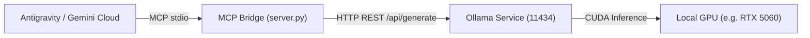

# ag-mcp-local-llm

Model Context Protocol (MCP) bridge connecting AI orchestrators (Google Antigravity, Claude Desktop, Cursor) with a locally running Ollama instance.

Designed for offloading computationally heavy code generation, log analysis, and large local file scans to your local GPU without consuming cloud token quotas.

---

## Architecture Overview



---

## Repository Structure

```text
ag-mcp-local-llm/
├── ARCHITECTURE_PLAN.md    # Technical blueprint and design decisions
├── README.md               # Setup and configuration guide
├── requirements.txt        # Python package dependencies
├── .env.example            # Environment variable template
├── .env                    # Active local environment variables (git-ignored)
├── .gitignore              # Standard Python gitignore rules
├── src/
│   ├── __init__.py
│   ├── config.py           # Settings loader with environment fallback
│   ├── client.py           # Async HTTP client for Ollama API
│   └── server.py           # FastMCP stdio server exposing tools
└── tests/
    ├── __init__.py
    └── test_connection.py  # Standalone diagnostic test script
```

---

## Exposed MCP Tools

| Tool Name | Parameters | Description |
| :--- | :--- | :--- |
| `ask_local_llm` | `prompt: str`, `model: str = ""` | Delegates a generation or drafting task to the local LLM. |
| `analyze_file_locally` | `file_path: str`, `instruction: str`, `model: str = ""` | Reads a local file on your machine and analyzes it locally without uploading content to the cloud. |
| `check_local_llm_status` | *None* | Verifies Ollama connectivity, version, default model, and installed models. |

---

## Prerequisites

1. **Python 3.10+** (tested on Python 3.14).
2. **Ollama** installed on your machine ([ollama.com](https://ollama.com)).
3. Dedicated GPU with CUDA support recommended (e.g. NVIDIA RTX series).

---

## Installation & Setup

### 1. Clone & Enter Directory
```bash
git clone https://github.com/Hansel-vlnt/ag-mcp-local-llm.git
cd ag-mcp-local-llm
```

### 2. Create Virtual Environment
```powershell
python -m venv .venv
.\.venv\Scripts\Activate.ps1
```

### 3. Install Dependencies
```bash
pip install -r requirements.txt
```

### 4. Configure Environment
Copy `.env.example` to `.env` (already created during setup) and adjust values if needed:
```ini
OLLAMA_HOST=http://127.0.0.1:11434
DEFAULT_MODEL=qwen2.5-coder:7b
REQUEST_TIMEOUT=120.0
DEFAULT_NUM_CTX=8192
```

### 5. Start Ollama and Pull a Model
Make sure the Ollama service is running:
```bash
ollama serve
```
Then pull your model of choice:
```bash
ollama pull qwen2.5-coder:7b
```

### 6. Run Diagnostic Check
Verify connection and inference using the included test script:
```bash
python tests/test_connection.py
```

---

## Client Integration

### Antigravity (`~/.gemini/config/mcp_config.json`)

Add the following entry under `mcpServers`:

```json
{
  "mcpServers": {
    "ag-mcp-local-llm": {
      "command": "D:\\mcp-local-llm\\.venv\\Scripts\\python.exe",
      "args": [
        "D:\\mcp-local-llm\\src\\server.py"
      ],
      "env": {
        "OLLAMA_HOST": "http://127.0.0.1:11434",
        "DEFAULT_MODEL": "qwen2.5-coder:7b"
      }
    }
  }
}
```

### Claude Desktop (`claude_desktop_config.json`)

```json
{
  "mcpServers": {
    "local-llm": {
      "command": "D:\\mcp-local-llm\\.venv\\Scripts\\python.exe",
      "args": [
        "D:\\mcp-local-llm\\src\\server.py"
      ]
    }
  }
}
```

---

## License

MIT
